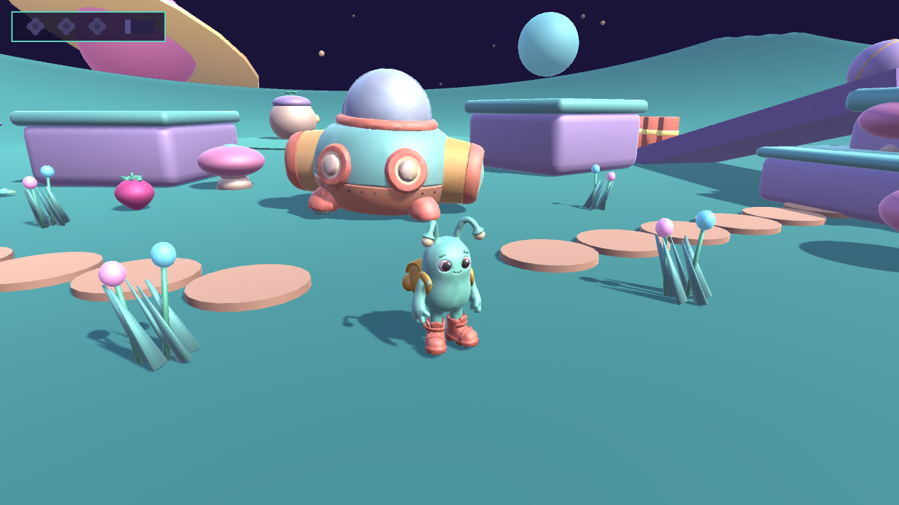
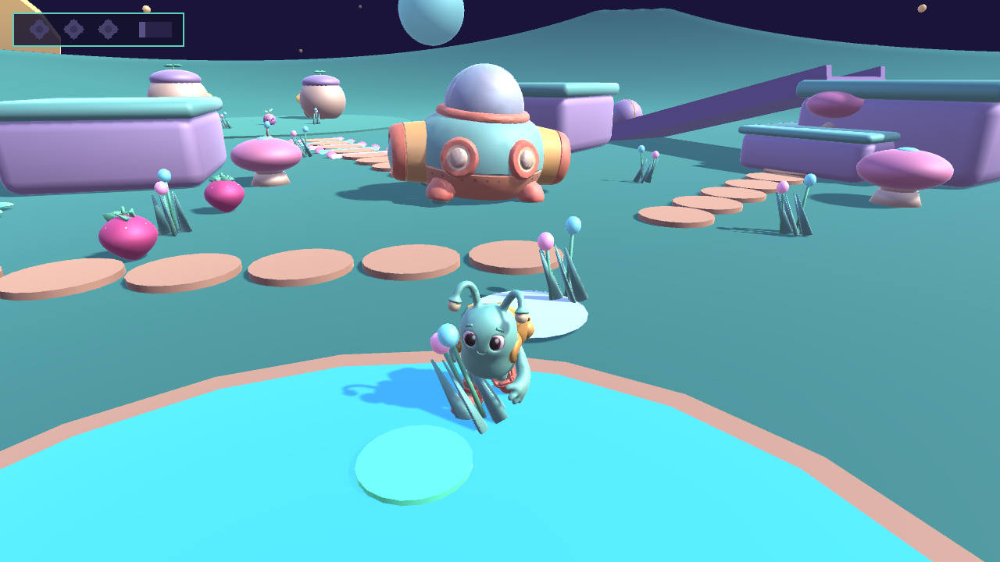
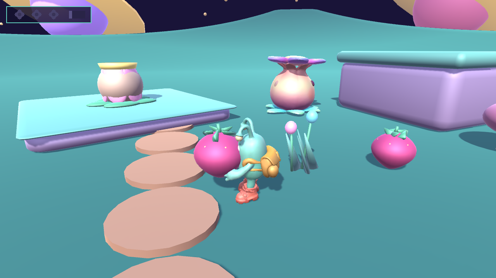
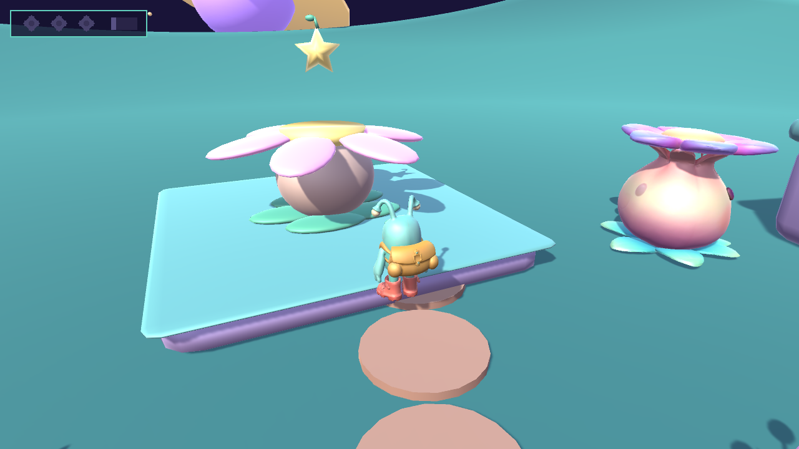
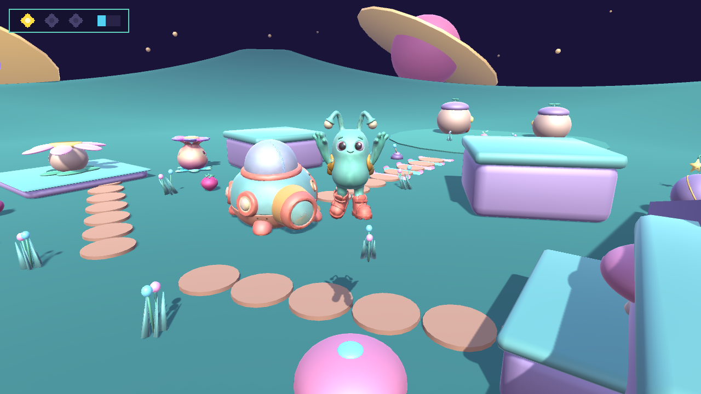
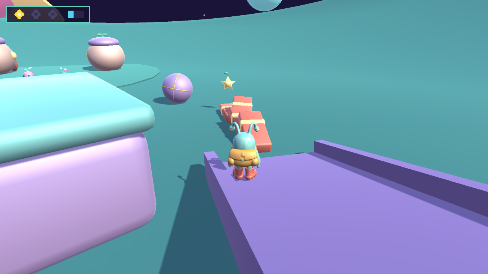
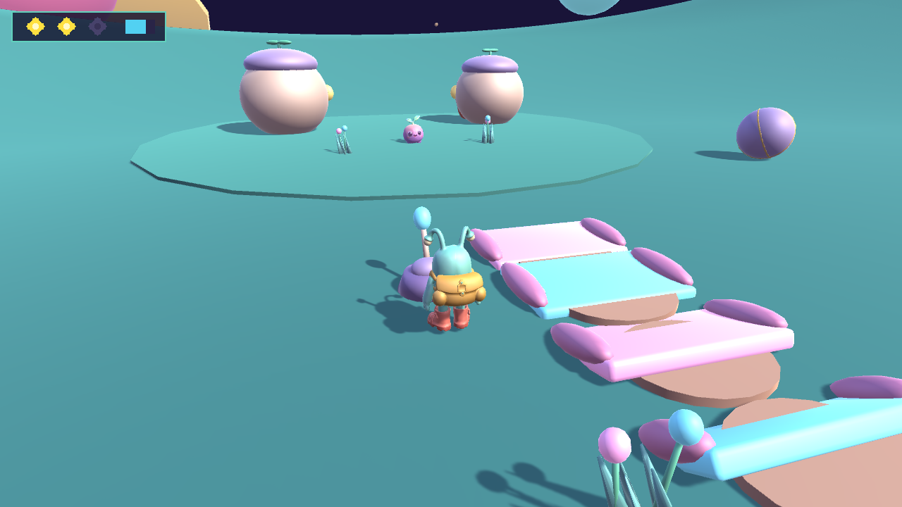
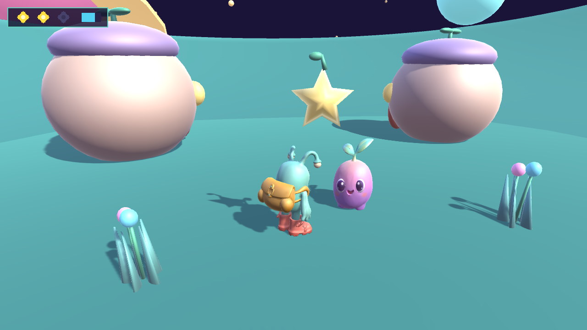
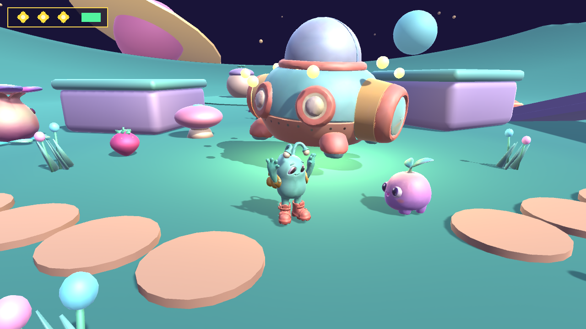

# Pocket Planet

**Pocket Planet** is an original, cute, fully playable third-person 3D exploration and platforming game set on a whimsical garden planet in space, built in **Unity 6 (`6000.3.20f1`)** with a complete **Concept Art → Customuse MCP 3D Generation → Blender 5.2 Cleanup, Rigging & 12-Clip Animation → Unity 6** pipeline.

You play as **Pip**, a small rounded mint-teal alien explorer with expressive glossy eyes, floppy glowing-tipped antennae, oversized coral boots, and a mustard-yellow star backpack. After your retro-cute explorer ship (**SS Starhopper**) breaks down in the central clearing, explore the terraced garden planet, collect **3 Star Seeds** through distinct physical interactions, return to the ship to repair it, and celebrate!

---

## Gameplay Screenshots (Captured Live from Running Unity 6 Standalone Build)

| Central Clearing & Broken SS Starhopper | Splashing in Shallow Pond & Responsive Flora |
| :---: | :---: |
|  |  |
| **Carrying Oversized Starberry (Weighted Pose)** | **Feeding Hungry Bloom-Plant (Star Seed #1)** |
|  |  |
| **Bouncing on Springy Jelly-Shrooms** | **Boulder Slope & Domino Topple (Star Seed #2)** |
|  |  |
| **Crystal Lever & Unfolding Petal Bridge** | **Petting Friendly Alien Bloop (Star Seed #3)** |
|  |  |

### In-Engine Ship Repair & Celebration


### Continuous Gameplay Showcase Video
- **Continuous In-Engine Recording (`MP4` + Audio)**: [`docs/gameplay_showcase.mp4`](docs/gameplay_showcase.mp4)

---

## Concept Art & Visual Reference Sheets (Pre-Production Concept Art Only)

> **Honest Attribution Note:** The images in `docs/concepts/` below were generated during pre-production via the built-in image generator to establish character proportions, color palettes, and prop silhouettes before 3D generation in Customuse MCP and rigging in Blender 5.2. They are **concept art reference sheets**, not gameplay screenshots.

| Hero "Pip" Front A-Pose Reference | Hero "Pip" Turnaround & Color Palette |
| :---: | :---: |
|  |  |
| **Garden Planet Environment Concept** | **Creatures & Interactive Props Sheet** |
|  |  |

---

## Core Adventure & Interactive Systems

1. **Oversized Starberry Pickup, Weighted Carry, Drop & Throw** ([`StarberryItem.cs`](Assets/PocketPlanet/Scripts/StarberryItem.cs), [`PipCharacterController.cs`](Assets/PocketPlanet/Scripts/PipCharacterController.cs))
   - Walk up to any plump magenta-gold Starberry and press **`E` / `F`** (or Gamepad **West / Square / X**) to pick it up.
   - Pip's hands meet the sides of the fruit, and Pip's posture leans back in a weighted carry waddle (`Carry` animation).
   - Press **`E` / `F`** near a Hungry Bloom-Plant to feed it, or press **`Q` / `R` / Left Click** (Gamepad **East / Circle / B**) to throw/drop the fruit with physics arc and out-of-bounds auto-respawn.
2. **Hungry Bloom-Plant → Flower Platform & Star Seed #1** ([`HungryBloomPlant.cs`](Assets/PocketPlanet/Scripts/HungryBloomPlant.cs))
   - Feed a Starberry (by hand or by throwing it into its mouth) to the Hungry Bloom-Plant in the West Bloom Garden.
   - It chews with squash-and-stretch, unfolds its 6 glowing flower petals into a solid platform, and reveals **Star Seed #1**.
3. **Springy Bouncy Jelly-Shrooms** ([`BouncyMushroom.cs`](Assets/PocketPlanet/Scripts/BouncyMushroom.cs))
   - Jump or walk onto the spotted pink Jelly-Shrooms to visibly squash the cap, trigger a damped spring recoil, and launch Pip high into the air toward elevated ridges.
4. **Pushable Slope Boulder & Domino Block Route → Star Seed #2** ([`PushableBoulder.cs`](Assets/PocketPlanet/Scripts/PushableBoulder.cs), [`DominoBlock.cs`](Assets/PocketPlanet/Scripts/DominoBlock.cs))
   - Climb the East ridge via the Jelly-Shrooms and push the stone `PushBall` down the sloped ramp to topple the row of 4 `DominoBlocks` and reveal **Star Seed #2**.
5. **Crystal Lever & Unfolding Petal Bridge** ([`CrystalLeverBridge.cs`](Assets/PocketPlanet/Scripts/CrystalLeverBridge.cs))
   - Pull the glowing `CrystalLever` on the North chasm edge (`E` / `F` or Gamepad **West**) to swing the crystal handle and sequentially unfold the 5-segment petal bridge across to the North Alien Pod Village.
6. **Friendly Alien Creature ("Bloop") Petting & Obstacle-Aware Following → Star Seed #3** ([`FriendlyAlienBloop.cs`](Assets/PocketPlanet/Scripts/FriendlyAlienBloop.cs))
   - Cross the unfolded bridge into the Alien Pod Village and pet **Bloop** (`E` / `F` or Gamepad **West**). Bloop spins happily, reveals **Star Seed #3**, and hops along behind Pip with raycast whisker obstacle avoidance and anti-stuck catch-up recovery.
7. **Sparkling Shallow Water Pond & Responsive Glowing Flora** ([`ShallowWaterZone.cs`](Assets/PocketPlanet/Scripts/ShallowWaterZone.cs), [`ResponsiveFlora.cs`](Assets/PocketPlanet/Scripts/ResponsiveFlora.cs))
   - Wading through the shallow crystal pond spawns expanding water-splash rings and water-splash footstep audio. Brushing through the bioluminescent flora tufts bends them away from Pip with spring-damper recovery and soft chime audio.
8. **SS Starhopper Repair & In-Engine Celebration** ([`StarhopperSpaceship.cs`](Assets/PocketPlanet/Scripts/StarhopperSpaceship.cs), [`PocketPlanetGameManager.cs`](Assets/PocketPlanet/Scripts/PocketPlanetGameManager.cs))
   - Return to the broken `SS Starhopper` in the central clearing with all **3 Star Seeds** and press **`E` / `F`** to repair it. The ship hovers smoothly, fanfare plays, Pip performs the `Celebrate` dance alongside Bloop, and an in-engine banner offers **Keep Exploring (`C`)** or **Restart Adventure (`Backspace`)**.
9. **Out-of-Bounds Recovery**
   - If Pip or any physics object (`Starberry`, `PushBall`) falls below `Y = -8.0m`, it automatically recovers to its last safe grounded checkpoint or spawn pedestal.

---

## Character Rig, 12 Authored Animations & Secondary Motion

- **Source Mesh**: Generated via **Customuse MCP** (`cr1` image-to-3D from `docs/concepts/hero_pip_front_a_pose.png` → [`tools/customuse_sources/pip_3d.glb`](tools/customuse_sources/pip_3d.glb), 14,352 triangles, 2048×2048 baked albedo).
- **Blender 5.2 Cleanup, 22-Bone Armature & Skinning**: Automated via [`tools/blender_rig_hero.py`](tools/blender_rig_hero.py), saving [`tools/blender_sources/Pip_Hero.blend`](tools/blender_sources/Pip_Hero.blend) and exporting [`PipBody.fbx`](Assets/PocketPlanet/Art/Characters/Pip/Native/PipBody.fbx) plus 12 animation FBXs:
  - `Idle`, `Walk`, `Run`, `Turn`, `Jump`, `Fall`, `Landing`, `Pickup`, `Carry`, `Throw`, `Interact`, `Celebrate`
- **Runtime Secondary Motion & Expressiveness** ([`PipCharacterController.cs`](Assets/PocketPlanet/Scripts/PipCharacterController.cs)):
  - **Floppy Antennae & Backpack Spring**: Velocity/acceleration-driven spring lag on `AntennaL_1/2`, `AntennaR_1/2`, and `Backpack` in `LateUpdate`.
  - **Look-At Behavior**: Smooth head yaw/pitch tracking toward the nearest interactable prop or creature within range.
  - **Expressive Blinking**: Periodic animated eyelid shells parented to the `Head` bone.
  - **Squash & Stretch**: Playful scale impulse and smooth recovery on jump takeoff, landing impact, turn pivots, and mushroom bounces.

---

## Controls (Tested with Keyboard/Mouse & Gamepad via Unity Input System)

| Action | Keyboard / Mouse | Gamepad (DualSense / Xbox) |
| :--- | :--- | :--- |
| **Move** | `W`, `A`, `S`, `D` or `Arrow Keys` | `Left Stick` |
| **Run / Sprint** | Hold `Left Shift` / `Right Shift` | Hold `L1 / LB` or `R2 / RT` |
| **Jump** (Coyote Time + Jump Buffer) | `Space` | `South Button` (`Cross` / `A`) |
| **Interact / Pick Up / Feed / Pet / Pull Lever / Repair Ship** | `E` or `F` | `West Button` (`Square` / `X`) |
| **Throw / Drop Carried Starberry** | `Q`, `R`, or `Left Mouse Click` | `East Button` (`Circle` / `B`) |
| **Orbit Camera** | Hold `Right Mouse Button` + Move Mouse, or `Q` / `E` | `Right Stick` |
| **Zoom Camera** | `Mouse Scroll Wheel` | — |
| **Toggle Controls Overlay** | `H` or `Tab` | — |
| **Keep Exploring (Post-Victory)** | `C` or On-Screen Button | On-Screen Button |
| **Restart Adventure** | `Backspace` or On-Screen Button | On-Screen Button |

---

## Setup, Build & Run Instructions

### Prerequisites
- **Unity Version**: `6000.3.20f1` (Unity 6 LTS)
- **Required Unity Packages** (configured in [`Packages/manifest.json`](Packages/manifest.json)):
  - `com.unity.inputsystem` (`1.18.0`)
  - `com.unity.ugui` (`2.0.0`)
  - Built-in `com.unity.modules.animation`, `physics`, `terrain`, `terrainphysics`, `audio`, `imgui`
- **Optional Asset Regeneration Tools**:
  - **Blender**: `5.2.0 LTS` (`/Applications/Blender.app/Contents/MacOS/Blender`)
  - **Python 3**: For regenerating the 20 synthesized PCM `.wav` sound effects and background music (`tools/generate_audio_assets.py`)

### 1. Open and Play in Unity Editor
1. Open the `/Users/midir/pocket-planet` project folder in **Unity Hub** using **Unity `6000.3.20f1`**.
2. Open the main scene at [`Assets/PocketPlanet/Scenes/PocketPlanet.unity`](Assets/PocketPlanet/Scenes/PocketPlanet.unity).
3. Press **Play** in the Editor (or use the top menu **`PocketPlanet -> Build Complete Scene & Configure Build Settings`** to rebuild the scene and prefabs from scratch).

### 2. Re-Run the Complete CLI Pipeline (Blender → Unity Import → Scene Build → macOS `.app` → Verification)
```bash
# 1. Regenerate rigged Hero Pip FBX + 12 animation clips from Customuse GLB in Blender 5.2
/Applications/Blender.app/Contents/MacOS/Blender -b -P tools/blender_rig_hero.py

# 2. Regenerate 14 world/prop FBXs (including Customuse Bloop, Spaceship, and Bloom-Plant) in Blender 5.2
/Applications/Blender.app/Contents/MacOS/Blender -b -P tools/blender_build_world_assets.py

# 3. Import all assets, build prefabs, assemble PocketPlanet.unity scene, and compile Builds/PocketPlanet.app
/Applications/Unity/Hub/Editor/6000.3.20f1/Unity.app/Contents/MacOS/Unity \
  -batchmode -nographics -quit \
  -projectPath /Users/midir/pocket-planet \
  -executeMethod PocketPlanet.Editor.PocketPlanetSceneBuilder.BuildAllBatch \
  -logFile Logs/unity_build.log

# 4. Run the automated batch verification suite
/Applications/Unity/Hub/Editor/6000.3.20f1/Unity.app/Contents/MacOS/Unity \
  -batchmode -nographics -quit \
  -projectPath /Users/midir/pocket-planet \
  -executeMethod PocketPlanet.Editor.PocketPlanetVerificationSuite.RunBatchVerification \
  -logFile Logs/unity_verify.log
```

### 3. Launch the Built macOS Standalone Game (`Builds/PocketPlanet.app`)
```bash
# Interactive Play Mode (Windowed 1280x720)
/Users/midir/pocket-planet/Builds/PocketPlanet.app/Contents/MacOS/pocket-planet -screen-width 1280 -screen-height 720 -screen-fullscreen 0

# Automated Full 3-Seed Adventure Playtest & Screenshot/Video Capture
/Users/midir/pocket-planet/Builds/PocketPlanet.app/Contents/MacOS/pocket-planet \
  -screen-width 1280 -screen-height 720 -screen-fullscreen 0 \
  -pocketMode full \
  -pocketCaptureDir /Users/midir/pocket-planet/docs/screenshots/gameplay \
  -pocketPerfJson /Users/midir/pocket-planet/docs/screenshots/gameplay/perf_full.json
```

---

## Measured Performance (Apple M3 Ultra, macOS Standalone Build)

Measured via [`PlaytestVerificationHarness.cs`](Assets/PocketPlanet/Scripts/PlaytestVerificationHarness.cs) and `gpu_slot.sh` at **1280×720 (`Ultra` Quality preset, 60 FPS target cap, VSync off)**:

| Benchmark Mode | Samples | Resolution & Quality | Average FPS | Median (`p50`) Frame Time | `p95` Frame Time | `1% Low` FPS (`p99`) | JSON Report |
| :--- | :---: | :---: | :---: | :---: | :---: | :---: | :--- |
| **Full 3-Seed Adventure (`gpu_slot.sh perf` clean pass, no disk frame-dump)** | 1,026 frames | `1280x720` (`Ultra`) | **58.7 FPS** (`17.04 ms`) | **16.69 ms** (`59.9 FPS`) | **17.58 ms** (`56.9 FPS`) | **52.1 FPS** (`19.18 ms`) | [`perf_full.json`](docs/screenshots/gameplay/perf_full.json) |
| **Milestone 1 Locomotion Pass (`milestone1`)** | 252 frames | `1280x720` (`Ultra`) | **56.9 FPS** (`17.56 ms`) | **16.67 ms** (`60.0 FPS`) | **16.71 ms** (`59.8 FPS`) | **30.2 FPS** (`33.09 ms`) | [`perf_milestone1.json`](docs/screenshots/milestone1/perf_milestone1.json) |

---

## AI / Tool Contributions & Known Limitations

### Honest Breakdown of AI & Tool Contributions
- **Concept Art (`docs/concepts/*.png`)**: Generated using the built-in `image-generator` subagent to establish character proportions, turnaround reference, color palette, and prop designs. Labeled honestly as pre-production concept art.
- **Customuse MCP 3D Generation (`tools/customuse_sources/*.glb`)**: Used Customuse MCP workflow canvas (`cb6e7680-32a8-4b4e-878e-a18ed2a39e8d`, `cr1` 3D model generator, 280 credits total within the owner-approved 600-credit budget) to generate 4 core 3D GLB assets with 2K textures:
  - `pip_3d.glb` (Hero Pip, 14,352 tris)
  - `bloop_3d.glb` (Friendly Alien Bloop, 9,594 tris)
  - `spaceship_3d.glb` (SS Starhopper Spaceship, 13,526 tris)
  - `bloom_plant_3d.glb` (Bioluminescent Flora Landmark, 11,343 tris)
- **Blender 5.2 LTS (`tools/blender_rig_hero.py`, `tools/blender_build_world_assets.py`)**: Used to clean up Customuse GLB meshes, normalize scale/orientation, build Pip's 22-bone armature and procedural distance-weighted skinning, author all 12 skeletal animation actions, and build modular articulated interactive props (`Starberry`, `StarSeed`, `BouncyShroom`, `PushBall`, `DominoBlock`, `CrystalLever`, `UnfoldingBridge`, `AlienPodHome`, `PastelRockPlatform`, `GlowingFloraTuft`).
- **Audio (`tools/generate_audio_assets.py`)**: Synthesized 20 original royalty-free 16-bit PCM `.wav` sound effects and a looping space-garden marimba/celesta background track (`bgm_pocket_planet.wav`).

### Known Limitations
- **Facial Expressions**: Pip's eyes use glossy 3D texture/mesh shading with procedural 3D eyelid blinking and head look-at tracking rather than skeletal facial blendshapes.
- **Gamepad Vibration / Haptics**: Standard Gamepad stick/button controls are supported via Unity Input System, but controller rumble motors are not currently triggered on bounce/landing.
- **Single-Scene Compact World**: As designed, the game takes place in one self-contained, freely explorable garden planet scene rather than streaming multiple separate planet levels.

---

## License & Asset Credits

- **Source Code & Scripts**: Licensed under the **MIT License** (see [`LICENSE`](LICENSE)).
- **3D Models, Textures, Audio & Concept Art**: See [`CREDITS.md`](CREDITS.md) for complete per-asset provenance, Customuse MCP workflow IDs, Blender source files, and redistribution terms.
