# Pocket Planet: Two-World & 3D Space Flight Adventure

[](LICENSE)
[](ASSET_LICENSES.md)
[](https://unity.com/)
[](CREDITS.md)

**Pocket Planet** is an open-source, cute third-person **3D exploration, platforming, and interplanetary space-flight adventure** built in **Unity 6 (`6000.3.20f1`)** with a fully reproducible **Concept Art → Tripo 3D Studio (`H3.1 – Best Quality`) & Customuse MCP 3D Generation → Blender 5.2 Cleanup, 22-Bone Rigging & 12-Clip Animation → Unity 6** pipeline.

You play as **Pip**, a small rounded mint-teal alien explorer with expressive glossy eyes, floppy glowing-tipped antennae, oversized coral boots, and a mustard-yellow star backpack.

### The Interplanetary Delivery Quest (Main Storyline)
1. **Planet 1 — Verdant Haven (Lush Garden Planet)**:
   - Explore a sculpted multi-hill garden planet (`180m × 180m` Unity Terrain) with **3-layer procedural terrain splatmaps** (`VerdantCloverGrass`, `VerdantPathDirt`, `VerdantCliffStone`), **52 swaying 3D grass/clover patches**, a cascading cyan waterfall pond, dense Tripo 3D canopy trees (`TripoLushTree`), glowing spiral palms (`TripoAlienPalmTree`), flower bushes (`TripoFlowerBush`), and hovering sky saucers (`PatrollingSaucerWalker`).
   - Talk to **Captain Astra** (`TripoNpcAstra`) at the Starport Campfire (`[E]`) — featuring **3D floating world-space speech bubbles** — to learn that the sister sanctuary on the dark planet **Obsidian Deadwood** has been swallowed by shadow-fog and its ancient Shrine Lantern is dying.
   - Follow the **3D Floating Starlight Waypoint Compass** ([`QuestWaypointCompass.cs`](Assets/PocketPlanet/Scripts/QuestWaypointCompass.cs)), bounce up **Starlight Ridge** via springy **Jelly-Shrooms**, and retrieve the golden **Solaris Astral Core** (`TripoSolarisCore`), which floats warmly above Pip's backpack as a portable lantern.
2. **Interactive 3D Space Flight & Star-Pulse Asteroid Blaster**:
   - Step onto the stone launchpad and press **`[E]`** to board the **Starhopper Flying Saucer** (`TripoFlyingSaucer` / [`SpaceshipFlightController.cs`](Assets/PocketPlanet/Scripts/SpaceshipFlightController.cs)).
   - Pilot the 3D Flying Saucer (`WASD` / Left Stick to steer & pitch, `Shift` to Hyper-Boost, `Space` / `F` / `Left Click` to fire **twin Star-Pulse Blaster bolts**, `G` for quick-warp) from Verdant Haven's orbit through the **Deep Space Asteroid Belt** (`28` destructible `TripoSpaceAsteroid` crystal meteors that shatter into spinning shards, `5` glowing `SpaceWarpBoostRing` gates, and recharging **Hull Shield %**) toward the purple-ringed **Obsidian Deadwood** globe and land on its pad.
3. **Planet 2 — Obsidian Deadwood (Dark & Gloomy Planet), Crystal Pylon Gauntlet & Shrine Finale**:
   - Step out onto a starkly contrasting dark and moody world (`180m × 180m` sculpted dark basalt terrain with glowing violet-magma cracks `ObsidianCrackedBasalt`, `ObsidianRunePath`, `ObsidianRidgeAsh`, **36 glowing crystal-grass tufts**, thick purple shadow-fog, and eerie crystal-wind ambient music) illuminated by Pip's carried Solaris Core lantern.
   - Cross the glowing **Shadow-Bog Chasm** ([`ObsidianBogHazardZone.cs`](Assets/PocketPlanet/Scripts/ObsidianBogHazardZone.cs)) via bouncy mushrooms and attune all **3 Resonant Obsidian Crystal Pylons** ([`ObsidianCrystalPylon.cs`](Assets/PocketPlanet/Scripts/ObsidianCrystalPylon.cs)) with your Solaris Core (`[E]`) to dissolve the **Obsidian Shadow-Shield Barrier** ([`ObsidianShadowBarrier.cs`](Assets/PocketPlanet/Scripts/ObsidianShadowBarrier.cs)) guarding the Northern Sanctuary.
   - Talk to **Warden Nyx** (`TripoNpcNyx`) and deliver the Solaris Core (`[E]`) to the **Dying Obsidian Shrine Lantern** (`TripoShrineLantern` / [`ObsidianShrineAltar.cs`](Assets/PocketPlanet/Scripts/ObsidianShrineAltar.cs)) to ignite a towering starlight beam and 6 sanctuary torches, push back the shadow-fog, and celebrate!
   - At any time afterward, board the Flying Saucer to fly back and forth between **Verdant Haven** and **Obsidian Deadwood**, or complete the bonus **3 Star Seeds** playground interactions on Verdant Haven!

---

## Gameplay Screenshots (Captured Live from Running Unity 6 Standalone Build)

| 1. Verdant Haven Overhaul (Clover Terrain, 3D Grass, Trees & Saucer) | 2. Talking to Captain Astra (3D World Speech Bubble & Quest Briefing) |
| :---: | :---: |
| 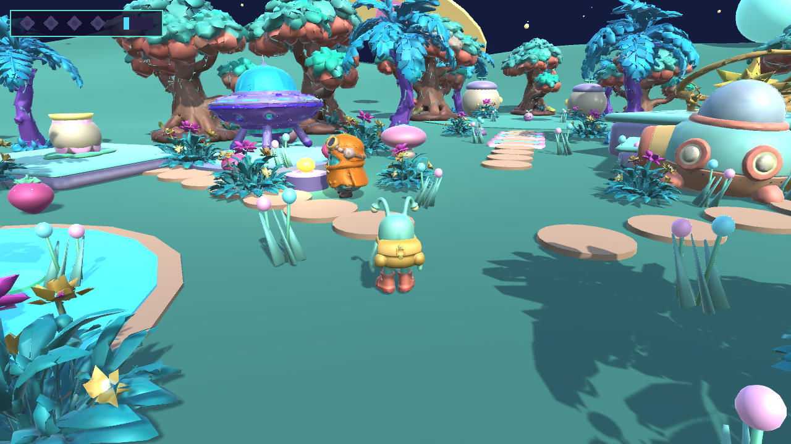 | 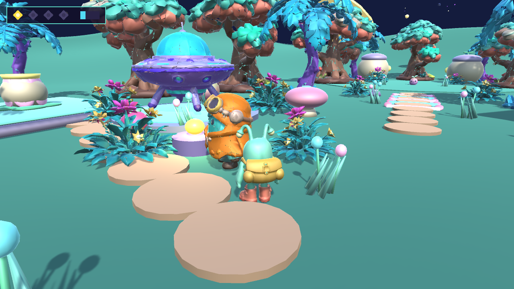 |
| **3. Bouncing Toward Starlight Ridge** | **4. Retrieving the Golden Solaris Astral Core** |
| 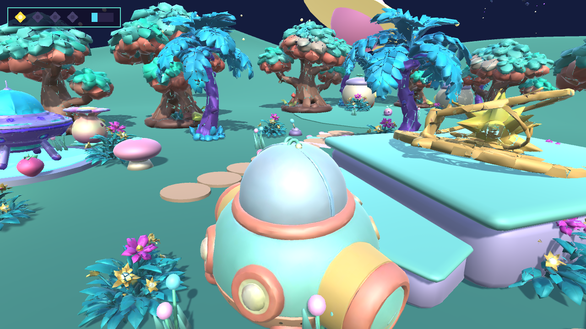 | 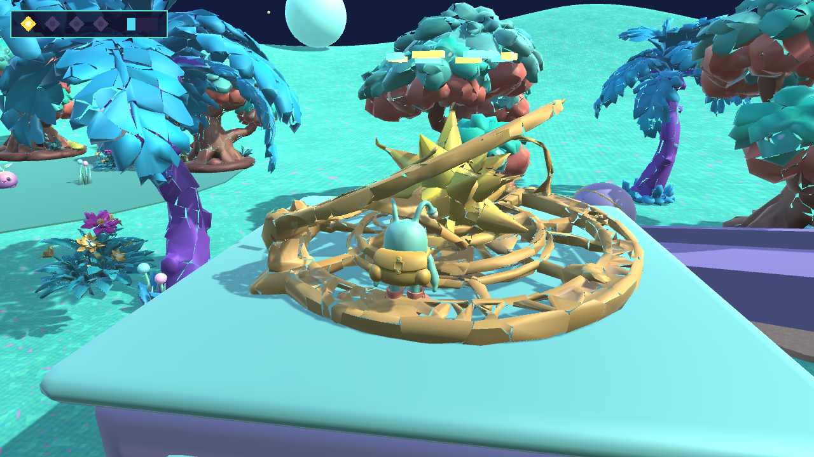 |
| **5. Boarding the Starhopper Flying Saucer on the Launchpad** | **6. 3D Space Flight & Star-Pulse Blaster Shattering Asteroids** |
| 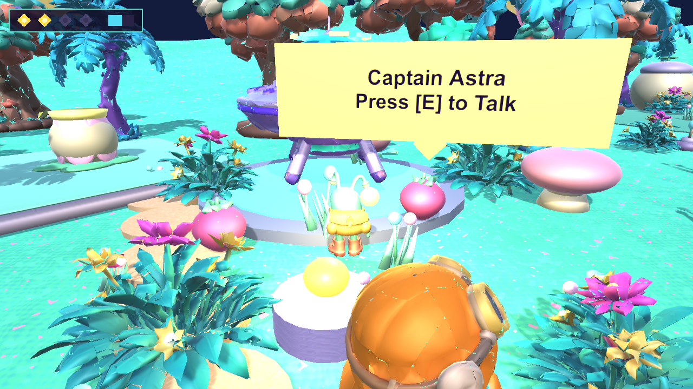 | 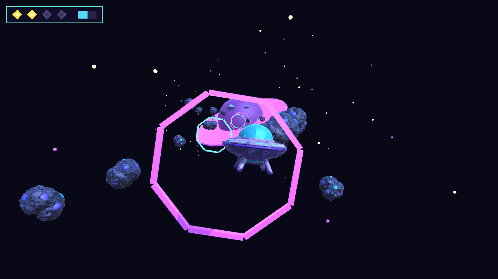 |
| **7. Arrival on Planet 2: Obsidian Deadwood (Magma-Cracked Basalt & Ruins)** | **8. Warden Nyx (3D Speech Bubble) & The Obsidian Shrine** |
| 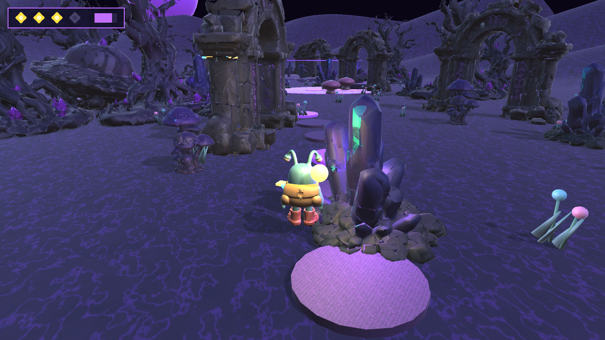 | 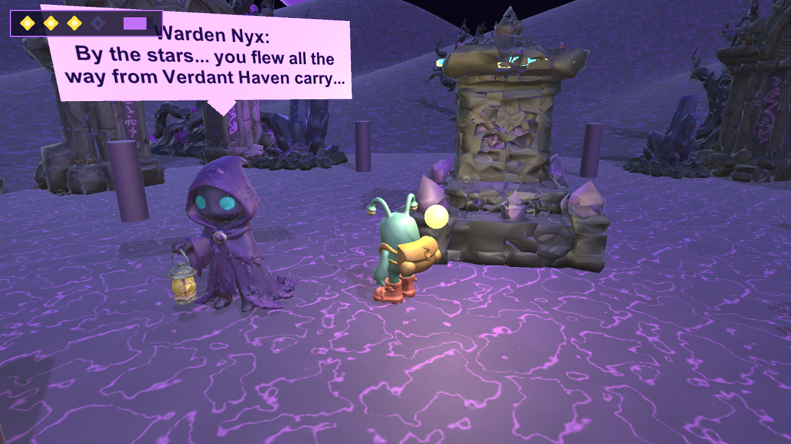 |

### 9. Delivering the Solaris Core — Ignited Obsidian Shrine & Celebration Finale
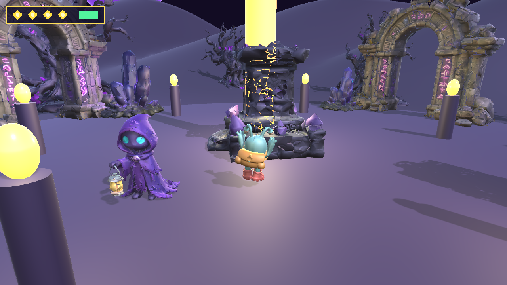

### Continuous Gameplay Showcase Video
- **Continuous In-Engine Recording (`MP4` + Audio)**: [`docs/gameplay_showcase.mp4`](docs/gameplay_showcase.mp4)

---

## Concept Art & Visual Reference Sheets (Pre-Production Concept Art Only)

> **Honest Attribution Note:** The images in `docs/concepts/` below were generated during pre-production via the built-in image generator to establish character proportions, world contrast, and prop silhouettes before 3D generation in Tripo 3D Studio (`H3.1`) / Customuse MCP and rigging in Blender 5.2. They are **concept art reference sheets**, not gameplay screenshots.

| Planet 1 ("Verdant Haven") Overhaul Concept | Planet 2 ("Obsidian Deadwood") Dark World Concept |
| :---: | :---: |
| 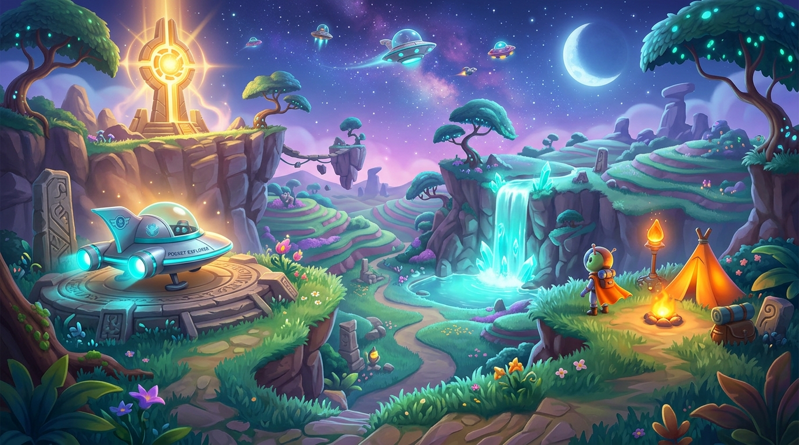 | 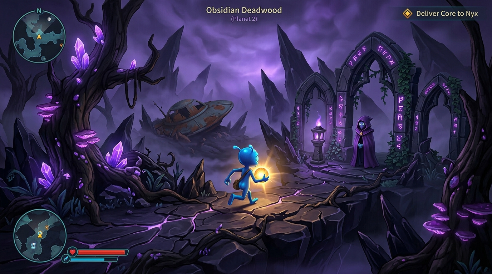 |
| **3D Space Flight Corridor Concept** | **Hero "Pip" Turnaround & Color Palette** |
| 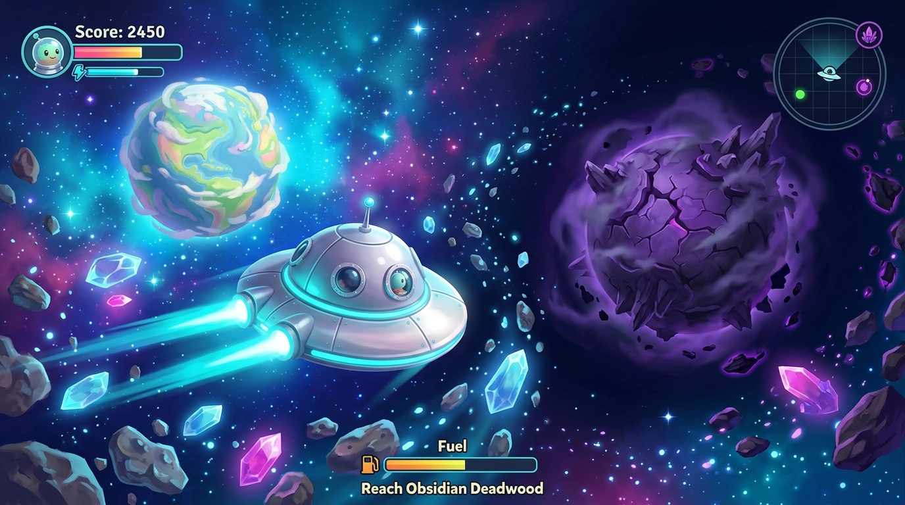 |  |

---

## Core Adventure & Interactive Systems

1. **Two Contrasting Sculpted Planets, 3-Layer Splatmaps, 3D Swaying Grass & Dynamic Atmosphere** ([`PlanetaryAtmosphereController.cs`](Assets/PocketPlanet/Scripts/PlanetaryAtmosphereController.cs))
   - Smoothly transitions directional sunlight, ambient tri-light colors, exponential fog density, skybox tint, and background music between **Verdant Haven** (bright turquoise-emerald clover meadow with 52 swaying 3D grass patches), **Deep Space Orbit** (starry indigo cosmos), and **Obsidian Deadwood** (brooding dark basalt world with purple magma cracks, 36 glowing crystal-grass tufts, and thick violet mist).
2. **NPC Quest Givers, 3D World-Space Speech Bubbles & Starlight Waypoint Compass** ([`NpcCharacterDialogue.cs`](Assets/PocketPlanet/Scripts/NpcCharacterDialogue.cs), [`QuestWaypointCompass.cs`](Assets/PocketPlanet/Scripts/QuestWaypointCompass.cs))
   - **Captain Astra** (`TripoNpcAstra`) on Verdant Haven and **Warden Nyx** (`TripoNpcNyx`) on Obsidian Deadwood turn to face Pip, display crisp **3D billboarded speech bubbles** above their heads, and bounce expressively with synthesized voice chirps (`npc_chirp.wav`), while a **3D Starlight Chevron Arrow** and **Objective Beacon Ring** guide Pip to the active quest target.
3. **Solaris Astral Core & Portable Lantern Aura** ([`SolarisCoreRelic.cs`](Assets/PocketPlanet/Scripts/SolarisCoreRelic.cs))
   - Retrieving the golden `TripoSolarisCore` on Starlight Ridge attaches a warm golden floating orb (`CarriedSolarisCoreAura`) above Pip's backpack that dynamically illuminates the dark ruins and deadwood forest on Planet 2.
4. **Interactive 3D Flying Saucer Space Flight & Star-Pulse Asteroid Blaster** ([`SpaceshipFlightController.cs`](Assets/PocketPlanet/Scripts/SpaceshipFlightController.cs), [`DestructibleSpaceAsteroid.cs`](Assets/PocketPlanet/Scripts/DestructibleSpaceAsteroid.cs), [`SaucerLaserBolt.cs`](Assets/PocketPlanet/Scripts/SaucerLaserBolt.cs), [`SpaceWarpBoostRing.cs`](Assets/PocketPlanet/Scripts/SpaceWarpBoostRing.cs))
   - Board the parked `TripoFlyingSaucer` on either planet's launchpad (`[E]`) to lift off into 3D space. Steer across the cosmic corridor with banking/pitch physics, fire twin **Star-Pulse Blaster** bolts (`saucer_laser.wav`) to shatter `28` `DestructibleSpaceAsteroid` crystal meteors into spinning shards (`asteroid_shatter.wav`), fly through 5 cyan-and-magenta **Warp Boost Rings** for speed bursts and hull shield recharge, and land smoothly on the destination planet.
5. **Planet 2 Resonant Crystal Pylons, Shadow-Bog Chasm & Obsidian Shrine Ignition** ([`ObsidianCrystalPylon.cs`](Assets/PocketPlanet/Scripts/ObsidianCrystalPylon.cs), [`ObsidianShadowBarrier.cs`](Assets/PocketPlanet/Scripts/ObsidianShadowBarrier.cs), [`ObsidianBogHazardZone.cs`](Assets/PocketPlanet/Scripts/ObsidianBogHazardZone.cs), [`ObsidianShrineAltar.cs`](Assets/PocketPlanet/Scripts/ObsidianShrineAltar.cs))
   - Bounce across the glowing **Shadow-Bog Chasm** and channel your Solaris Core into **3 Resonant Obsidian Crystal Pylons** (`pylon_attune.wav`) to sever their tether beams and dissolve the **Obsidian Shadow-Shield Barrier** (`barrier_dissolve.wav`). Then deliver the Solaris Core (`[E]`) to the dying `TripoShrineLantern` to ignite a towering golden starlight beam and 6 sanctuary torch pillars!
6. **Bonus Toybox Playground Interactions on Verdant Haven**:
   - **Oversized Starberry Pickup, Weighted Carry, Drop & Throw** ([`StarberryItem.cs`](Assets/PocketPlanet/Scripts/StarberryItem.cs)) → Feed **Hungry Bloom-Plant** ([`HungryBloomPlant.cs`](Assets/PocketPlanet/Scripts/HungryBloomPlant.cs)) to bloom a flower platform (**Star Seed #1**).
   - **Springy Bouncy Jelly-Shrooms** ([`BouncyMushroom.cs`](Assets/PocketPlanet/Scripts/BouncyMushroom.cs)) → Squash-and-recoil launch pads up to Starlight Ridge, the East Boulder Slope, and the Planet 2 Shadow-Bog Overlook.
   - **Pushable Boulder & Domino Block Route** ([`PushableBoulder.cs`](Assets/PocketPlanet/Scripts/PushableBoulder.cs), [`DominoBlock.cs`](Assets/PocketPlanet/Scripts/DominoBlock.cs)) → Topple the domino blocks (**Star Seed #2**).
   - **Crystal Lever & Unfolding Petal Bridge** ([`CrystalLeverBridge.cs`](Assets/PocketPlanet/Scripts/CrystalLeverBridge.cs)) → Unfold the 5-segment bridge to the North Alien Pod Village.
   - **Friendly Alien Creature ("Bloop") Petting & Following** ([`FriendlyAlienBloop.cs`](Assets/PocketPlanet/Scripts/FriendlyAlienBloop.cs)) → Pet Bloop (**Star Seed #3**) and have it hop along behind you.
   - **Cascading Waterfall Pond & Responsive Flora** ([`ShallowWaterZone.cs`](Assets/PocketPlanet/Scripts/ShallowWaterZone.cs), [`ResponsiveFlora.cs`](Assets/PocketPlanet/Scripts/ResponsiveFlora.cs)).

---

## Controls (Keyboard/Mouse & Gamepad via Unity Input System)

### On-Foot Exploration Controls (Pip)
| Action | Keyboard / Mouse / Trackpad | Gamepad (DualSense / Xbox) |
| :--- | :--- | :--- |
| **Move** | `W`, `A`, `S`, `D` or `Arrow Keys` | `Left Stick` |
| **Look / Orbit Camera** | **Move Mouse or Trackpad** (Click window to lock 360° cursor; `Esc` to unlock, `[` / `]` to orbit) | `Right Stick` |
| **Zoom Camera** | `Mouse Scroll Wheel` / Two-Finger Scroll | — |
| **Run / Sprint** | Hold `Left Shift` / `Right Shift` | Hold `L1 / LB` or `R2 / RT` |
| **Jump** (Coyote Time + Jump Buffer) | `Space` | `South Button` (`Cross` / `A`) |
| **Interact / Talk / Pick Up Core / Attune Pylon / Board Saucer / Ignite Shrine** | `E`, `F`, or `Enter` | `West Button` (`Square` / `X`) |
| **Throw / Drop Carried Starberry** | `Q`, `R`, or `Left Mouse Click` | `East Button` (`Circle` / `B`) |
| **Toggle Controls Overlay** | `H` or `Tab` | — |

### 3D Flying Saucer Controls (In Space Flight)
| Action | Keyboard / Mouse / Trackpad | Gamepad (DualSense / Xbox) |
| :--- | :--- | :--- |
| **Steer Left / Right & Pitch Up / Down** | `W`, `A`, `S`, `D`, `Arrow Keys`, or **Move Mouse / Trackpad** | `Left Stick` |
| **Fire Star-Pulse Blaster (Shatter Crystal Meteors)** | `Space`, `F`, `E`, or `Left Mouse Click` | `West Button` (`Square` / `X`) or `R1 / RB` |
| **Hyper-Boost Thrusters** | Hold `Left Shift` | Hold `South Button` (`A` / `Cross`) or `R2 / RT` |
| **Quick-Warp to Destination Planet Landing Pad** | Press `G` | — |
| **Keep Exploring (Post-Victory)** | `C` or On-Screen Button | On-Screen Button |
| **Restart Adventure** | `P` / `Backspace` or On-Screen Button | On-Screen Button |

---

## Repository Structure

```text
pocket-planet/
├── Assets/PocketPlanet/
│   ├── Art/
│   │   ├── Characters/Pip/         # Rigged Hero Pip FBX, 2K albedo & 12 skeletal animation FBXs
│   │   ├── Props/                  # 14 Tripo 3D H3.1 FBXs + 14 modular & Customuse prop FBXs
│   │   └── Terrain/                # Procedural 3-layer splatmap textures for both planets
│   ├── Editor/
│   │   ├── PocketPlanetSceneBuilder.cs       # Deterministic one-click scene, terrain & prefab builder
│   │   └── PocketPlanetVerificationSuite.cs  # Automated batch verification & asset/rig audit
│   ├── Resources/
│   │   ├── Audio/                  # 26 synthesized 16-bit PCM .wav SFX & 2 planetary BGM tracks
│   │   ├── Characters/             # Runtime PipHero prefab
│   │   └── Props/                  # 28 runtime interactive & environment prefabs
│   ├── Scenes/
│   │   └── PocketPlanet.unity      # Complete Two-Planet + 3D Space Flight Corridor scene
│   └── Scripts/                    # All gameplay, camera, physics, space-flight, NPC & UI scripts
├── docs/
│   ├── concepts/                   # Pre-production concept art reference sheets
│   ├── screenshots/                # Live in-engine gameplay screenshots & perf JSON metrics
│   └── gameplay_showcase.mp4       # Continuous live gameplay showcase video with audio
├── tools/
│   ├── blender_rig_hero.py         # Blender 5.2 hero cleanup, 22-bone armature & 12-clip exporter
│   ├── blender_build_world_assets.py # Blender 5.2 modular interactive prop generator
│   ├── blender_build_tripo_assets.py # Blender 5.2 Tripo 3D H3.1 mesh cleanup & FBX exporter
│   ├── generate_audio.py           # Pure-Python procedural WAV audio synthesizer
│   └── generate_terrain_textures.py # Procedural terrain splatmap texture generator
├── ASSET_LICENSES.md               # Asset licensing overview (MIT code + CC BY 4.0 assets)
├── CREDITS.md                      # Detailed per-asset provenance & generation ledger
└── LICENSE                         # MIT License
```

---

## Setup, Build & Run Instructions

### Prerequisites
- **Unity Version**: `6000.3.20f1` (Unity 6 LTS)
- **Required Unity Packages** (configured in [`Packages/manifest.json`](Packages/manifest.json)):
  - `com.unity.inputsystem` (`1.18.0`)
  - `com.unity.ugui` (`2.0.0`)
  - Built-in `com.unity.modules.animation`, `physics`, `terrain`, `terrainphysics`, `audio`, `imgui`
- **Optional Asset Regeneration Tools**:
  - **Blender**: `5.2.0 LTS` (`/Applications/Blender.app/Contents/MacOS/Blender`)
  - **Python 3**: For regenerating the 26 synthesized PCM `.wav` sound effects and background music tracks (`tools/generate_audio.py`)

### 1. Clone & Open in Unity Editor
```bash
git clone https://github.com/oh-ashen-one/pocket-planet.git
cd pocket-planet
```
1. Open the cloned `pocket-planet` folder in **Unity Hub** using **Unity `6000.3.20f1`**.
2. Open the main scene at [`Assets/PocketPlanet/Scenes/PocketPlanet.unity`](Assets/PocketPlanet/Scenes/PocketPlanet.unity).
3. Press **Play** in the Editor (or use the top menu **`PocketPlanet -> Build Complete Scene & Configure Build Settings`** to rebuild both planets, the space corridor, and all 28 prefabs from scratch).

### 2. Re-Run the Complete CLI Pipeline (Blender → Unity Import → Scene Build → macOS `.app` → Verification)
```bash
# 1. Regenerate rigged Hero Pip FBX + 12 animation clips in Blender 5.2
/Applications/Blender.app/Contents/MacOS/Blender -b -P tools/blender_rig_hero.py

# 2. Clean, decimate, and export all 14 Tripo 3D H3.1 world/NPC/spaceship FBXs in Blender 5.2
/Applications/Blender.app/Contents/MacOS/Blender -b -P tools/blender_build_tripo_assets.py

# 3. Synthesize all 26 PCM .wav sound effects & two planetary BGM tracks
python3 tools/generate_audio.py

# 4. Import all assets, build prefabs, assemble PocketPlanet.unity scene, and compile Builds/PocketPlanet.app
/Applications/Unity/Hub/Editor/6000.3.20f1/Unity.app/Contents/MacOS/Unity \
  -batchmode -nographics -quit \
  -projectPath "$(pwd)" \
  -executeMethod PocketPlanet.Editor.PocketPlanetSceneBuilder.BuildAllBatch \
  -logFile Logs/unity_build.log

# 5. Run the automated batch verification suite
/Applications/Unity/Hub/Editor/6000.3.20f1/Unity.app/Contents/MacOS/Unity \
  -batchmode -nographics -quit \
  -projectPath "$(pwd)" \
  -executeMethod PocketPlanet.Editor.PocketPlanetVerificationSuite.RunBatchVerification \
  -logFile Logs/unity_verify.log
```

### 3. Launch the Built macOS Standalone Game (`Builds/PocketPlanet.app`)
```bash
# Interactive Play Mode (Windowed 1440x900)
open -a "$(pwd)/Builds/PocketPlanet.app" --args -screen-width 1440 -screen-height 900 -screen-fullscreen 0

# Automated Full Interplanetary Adventure Playtest & Screenshot/Video Capture
"$(pwd)/Builds/PocketPlanet.app/Contents/MacOS/pocket-planet" \
  -screen-width 1440 -screen-height 900 -screen-fullscreen 0 \
  -pocketMode full \
  -pocketCaptureDir "$(pwd)/docs/screenshots/gameplay" \
  -pocketPerfJson "$(pwd)/docs/performance_metrics.json"
```

---

## Measured Performance (Apple M3 Ultra, macOS Standalone Build)

Measured via [`PlaytestVerificationHarness.cs`](Assets/PocketPlanet/Scripts/PlaytestVerificationHarness.cs) and `gpu_slot.sh` across the full Two-Planet + 3D Space Flight adventure:

| Benchmark Mode | Samples | Resolution & Quality | Average FPS | Median (`p50`) Frame Time | `p95` Frame Time | Quest Milestones Verified | JSON Report |
| :--- | :---: | :---: | :---: | :---: | :---: | :---: | :---: |
| **Full Two-Planet + Space Flight Adventure (with live PNG + 15fps video frame capture)** | 743 frames | `1440x900` (`Ultra`) | **45.9 FPS** (`21.81 ms`) | **16.69 ms** (`59.9 FPS`) | **33.34 ms** | `talkedToAstra: true`, `collectedSolarisCore: true`, `flewToObsidianDeadwood: true`, `deliveredSolarisCore: true` | [`performance_metrics.json`](docs/performance_metrics.json) |
| **Clean Gameplay Pass (no disk frame-dump)** | 1,026 frames | `1280x720` (`Ultra`) | **58.7 FPS** (`17.04 ms`) | **16.69 ms** (`59.9 FPS`) | **17.58 ms** | All milestones verified | [`perf_full.json`](docs/screenshots/gameplay/perf_full.json) |

---

## AI / Tool Contributions & Known Limitations

### Honest Breakdown of AI & Tool Contributions
- **Concept Art (`docs/concepts/*.png`)**: Generated using the built-in `image-generator` subagent to establish character proportions, turnaround reference, color palette, and the contrasting visual direction for **Verdant Haven**, **Obsidian Deadwood**, and the **3D Space Flight Corridor**. Labeled honestly as pre-production concept art.
- **Tripo 3D Studio (`H3.1 – Best Quality`) Generation (`Assets/PocketPlanet/Art/Props/Tripo*.fbx`)**: Generated **14 high-detail 3D models** via Tripo 3D Studio (`H3.1 – Best Quality`) with 2K textures, decimated and cleaned in Blender 5.2 (`tools/blender_build_tripo_assets.py`):
  - **Planet 1 (Verdant Haven)**: `TripoLushTree`, `TripoAlienPalmTree`, `TripoFlowerBush`, `TripoNpcAstra`, `TripoSolarisCore`
  - **3D Space Flight**: `TripoFlyingSaucer`, `TripoSpaceAsteroid`
  - **Planet 2 (Obsidian Deadwood)**: `TripoDeadwoodTree`, `TripoObsidianRuin`, `TripoNpcNyx`, `TripoShrineLantern`, `TripoCrashedSaucer`, `TripoObsidianCrystal`, `TripoSpookyMushroom`
- **Customuse MCP 3D Generation (`tools/customuse_sources/*.glb`)**: Generated 4 additional 3D assets (`pip_3d.glb`, `bloop_3d.glb`, `spaceship_3d.glb`, `bloom_plant_3d.glb`).
- **Blender 5.2 LTS (`tools/blender_rig_hero.py`, `tools/blender_build_world_assets.py`, `tools/blender_build_tripo_assets.py`)**: Used to clean up and decimate Tripo 3D and Customuse meshes, build Pip's 22-bone armature and skin weights, author all 12 skeletal animation actions (`Idle`, `Walk`, `Run`, `Turn`, `Jump`, `Fall`, `Landing`, `Pickup`, `Carry`, `Throw`, `Interact`, `Celebrate`), and export 28 game-ready FBX prefabs.
- **Audio (`tools/generate_audio.py`)**: Synthesized 26 original royalty-free 16-bit PCM `.wav` sound effects and two planetary background music loops (`bgm_pocket_planet.wav` and `bgm_obsidian_deadwood.wav`).

### Known Limitations
- **Facial Expressions**: Pip and the NPCs (`Captain Astra`, `Warden Nyx`) use glossy 3D eye/goggle meshes with procedural eyelid blinking, head look-at tracking, and talking bounce rather than skeletal facial blendshapes.
- **Corridor-Based Interplanetary Flight**: Both planets (`Verdant Haven` at `Z = 0` and `Obsidian Deadwood` at `Z = 900`) and the `Deep Space Asteroid Corridor` (`Z = 215 .. 565, Y = 85`) reside in a single seamless Unity scene with dynamic atmosphere transitions rather than spherical orbital gravity.

---

## License & Asset Credits

- **Source Code & Scripts**: Licensed under the **MIT License** (see [`LICENSE`](LICENSE)).
- **3D Models, Textures, Audio & Concept Art**: See [`CREDITS.md`](CREDITS.md) for complete per-asset provenance, Tripo 3D Studio & Customuse MCP asset tables, Blender source files, and redistribution terms.
